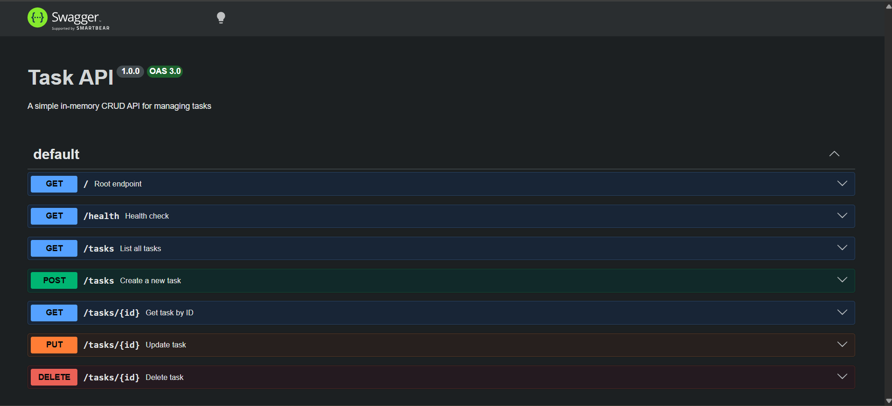
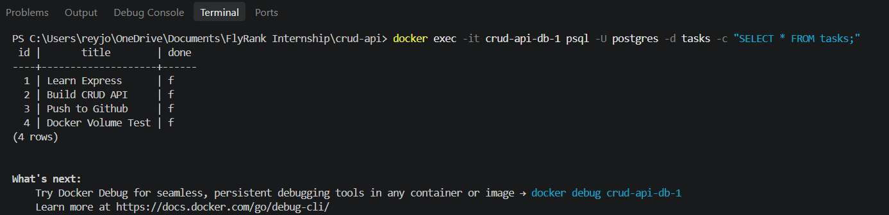

Markdown
# Task Management CRUD API

A lightweight server-side REST API built with Node.js and Express that manages a to-do list backed by a persistent database, fully containerized with Docker Compose.

This project evolved across FlyRank Backend AI Engineering internship assignments (`BE-01`, `BE-02`, and `BE-04`):
- **BE-01**: Express REST API with in-memory storage and Swagger UI documentation.
- **BE-02**: Integrated embedded **SQLite** database (`tasks.db`) using `better-sqlite3`[cite: 1].
- **BE-04**: Containerized the entire stack with **Docker Compose**, migrating storage to a **PostgreSQL 16** database container with volume persistence[cite: 1].

---

## 🗄️ Database Architecture & Migration

### 1. SQLite Integration (Assignment 2)
- **Why SQLite originally?** SQLite was chosen because it is lightweight, zero-configuration, and runs embedded directly within Node.js via `better-sqlite3`[cite: 1]. It required no separate database server installation while guaranteeing task data persisted across server restarts[cite: 1].
- **Database Location:** Stored as `tasks.db` in the project root directory[cite: 1].

### 2. PostgreSQL & Docker Containerization (Assignment 3 / BE-04)
- **Why PostgreSQL?** Upgraded to a production-grade, standalone database engine running inside a Docker container (`postgres:16`)[cite: 1].
- **Secrets Management:** Environment variables are loaded via `.env` (`DATABASE_URL=postgres://postgres:dev@db:5432/tasks`)[cite: 1]. `.env` is git-ignored for security, while a template `.env.example` is committed[cite: 1].
- **Data Persistence:** Data is mounted to a named Docker Volume (`taskdata`) so all database records outlive container restarts[cite: 1].
- **Architecture Layering Integrity:** Swapping from SQLite to PostgreSQL only required updating the database pool initialization and query layer (`pg`)[cite: 1]. All API routes (`GET`, `POST`, `PUT`, `DELETE`), validation logic, status codes, and Swagger UI documentation remained completely unchanged—proving clean software layering[cite: 1].

---

## 🚀 Features & Endpoints

| Method | Endpoint | Description | Status Code |
| :--- | :--- | :--- | :--- |
| `GET` | `/` | API Metadata | `200 OK` |
| `GET` | `/health` | Server Health Check | `200 OK` |
| `GET` | `/tasks` | List all tasks from PostgreSQL | `200 OK` |
| `GET` | `/tasks/:id` | Get single task by ID | `200 OK` / `404 Not Found` |
| `POST` | `/tasks` | Create a new task | `201 Created` / `400 Bad Request` |
| `PUT` | `/tasks/:id` | Update task title/status | `200 OK` / `400 Bad Request` / `404 Not Found` |
| `DELETE` | `/tasks/:id` | Remove a task by ID | `204 No Content` / `404 Not Found` |
| `GET` | `/docs` | Interactive Swagger UI | `200 OK` |

---

## 🛠️ How to Install and Run

### Option A: Docker Compose (Recommended - BE-04)

1. Clone the repository:
   ```bash
   git clone <YOUR_GITHUB_REPO_URL>
   cd crud-api
Create .env from template:

Bash
cp .env.example .env
Start the API and PostgreSQL database together with a single command:

Bash
docker compose up --build
Access the API at http://localhost:3000 or open Swagger UI at http://localhost:3000/docs.

Option B: Local Node.js Development
Start PostgreSQL container independently:

PowerShell
docker run --name taskdb -e POSTGRES_PASSWORD=dev -e POSTGRES_DB=tasks -p 5432:5432 -v taskdata:/var/lib/postgresql/data -d postgres:16
Install dependencies & run server:

PowerShell
npm install
node server.js
🔍 SQL Exploration & Direct Querying
SQLite Testing (Assignment 2)
Executed directly against tasks.db:

SQL
SELECT * FROM tasks WHERE done = 1;
PostgreSQL Testing (Assignment 3 / BE-04)
Executed directly inside the PostgreSQL container using psql[cite: 1]:

PowerShell
docker exec -it crud-api-db-1 psql -U postgres -d tasks -c "SELECT * FROM tasks;"
Terminal Output:

Plaintext
 id |       title        | done 
----+--------------------+------
  1 | Learn Express      | f
  2 | Build CRUD API     | f
  3 | Push to Github     | f
  4 | Docker Volume Test | f
(4 rows)
💾 Volume Persistence Proof (BE-04)
Data persistence across full stack restarts was verified with the following steps[cite: 1]:

Created a new task:

PowerShell
Invoke-RestMethod -Uri "http://localhost:3000/tasks" -Method Post -ContentType "application/json" -Body '{"title":"Docker Volume Test"}'
Tore down the container stack:

PowerShell
docker compose down
Restarted the stack:

PowerShell
docker compose up -d
Verified data survival:
GET /tasks returned all 4 tasks (including Docker Volume Test), confirming that the named volume taskdata safely retained all database state across container destruction[cite: 1].

🧪 Sample Request & Response (curl)
Bash
$ curl.exe -i -X PUT http://localhost:3000/tasks/1 -H "Content-Type: application/json" -d '{"done":true}'

HTTP/1.1 200 OK
X-Powered-By: Express
Content-Type: application/json; charset=utf-8
Content-Length: 44
Date: Wed, 28 Oct 2026 08:23:25 GMT

{"id":1,"title":"Learn Express","done":true}
📖 Swagger UI & Database Documentation

Interactive Swagger documentation is available at http://localhost:3000/docs.


### Database Terminal Verification
