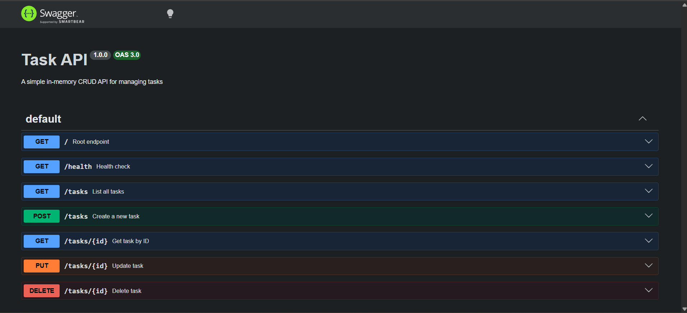

# Task Management CRUD API

A lightweight server-side REST API built with Node.js and Express that manages a to-do list using in-memory storage. 

This project was built as part of the FlyRank Backend AI Engineering internship assignment (`BE-01`).

## 🚀 Features & Endpoints

| Method | Endpoint | Description | Status Code |
| :--- | :--- | :--- | :--- |
| `GET` | `/` | API Metadata | `200 OK` |
| `GET` | `/health` | Server Health Check | `200 OK` |
| `GET` | `/tasks` | List all tasks | `200 OK` |
| `GET` | `/tasks/:id` | Get single task by ID | `200 OK` / `404 Not Found` |
| `POST` | `/tasks` | Create a new task | `201 Created` / `400 Bad Request` |
| `PUT` | `/tasks/:id` | Update task title/status | `200 OK` / `400 Bad Request` / `404 Not Found` |
| `DELETE` | `/tasks/:id` | Remove a task by ID | `204 No Content` / `404 Not Found` |
| `GET` | `/docs` | Interactive Swagger UI | `200 OK` |

---

## 🛠️ How to Install and Run

### Prerequisites
- Node.js installed on your machine.

### Setup
1. Clone the repository:
   ```bash
   git clone <YOUR_GITHUB_REPO_URL>
   cd crud-api
   ```
2. Install dependencies:
   ```bash
   npm install
   ```
3. Start the server:
   ```bash
   node server.js
   ```
4. Access the API at `http://localhost:3000` or open Swagger UI at `http://localhost:3000/docs`.

---

## 🧪 Sample Request & Response (`curl`)

```bash
$ curl.exe -i -X PUT http://localhost:3000/tasks/1 -H "Content-Type: application/json" -d '{\"done\":true}'

HTTP/1.1 200 OK
X-Powered-By: Express
Content-Type: application/json; charset=utf-8
Content-Length: 44
Date: Wed, 28 Oct 2026 08:23:25 GMT

{"id":1,"title":"Learn Express","done":true}
```

---

## 📖 Swagger UI


